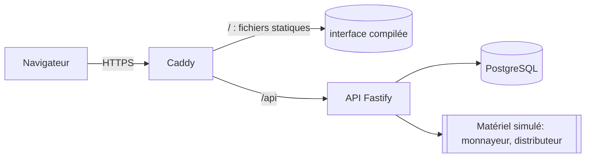
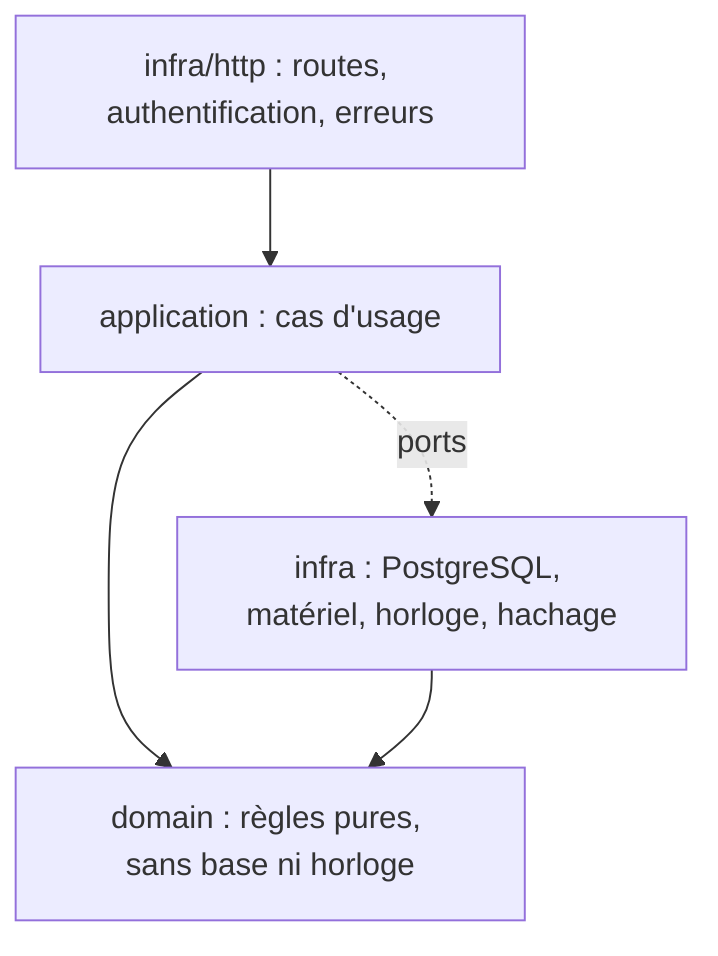
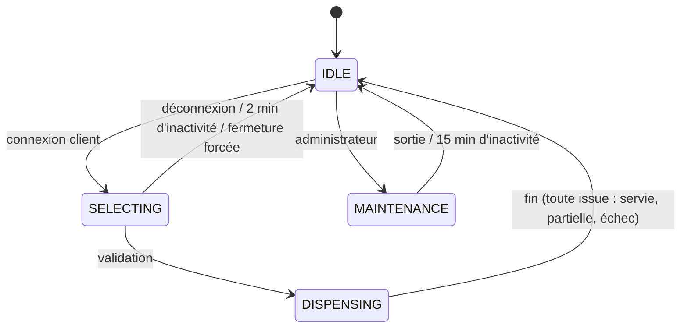
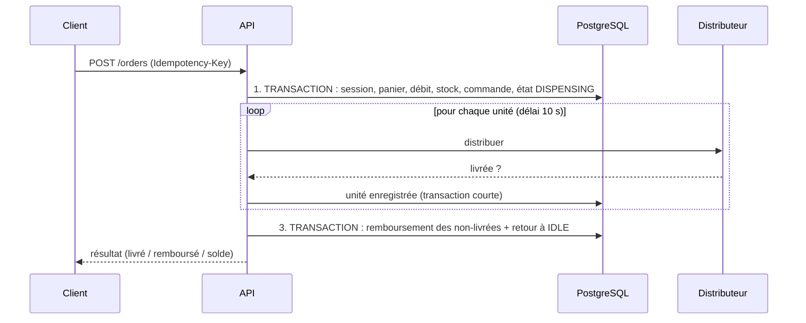

# Architecture

Un seul point d'entrée : l'interface et l'API partagent la **même origine** (cookie `SameSite=Strict`, pas de CORS).

## Couches du serveur

`domain` n'importe rien d'autre que `shared`. Les règles d'argent, de panier, de remboursement et la machine à états y sont des **fonctions pures**, testées en propriétés. `application` orchestre dans des transactions ; `infra` branche la base et le matériel.

## Machine à états (globale, un seul propriétaire)

L'expiration est évaluée **à la demande** (pas de minuteur) ; `DISPENSING` n'expire jamais.

## Commande : trois phases

Aucun verrou n'est tenu pendant l'appel au matériel. Un crash laisse la commande « en cours » : la **reprise au démarrage** la clôt avec les unités réellement enregistrées.

## Invariants garantis par la base (en plus du code)

Solde et stock **maintenus par déclencheurs** ; registres en ajout seul ; une seule commande en cours ; au plus un achat et un remboursement par commande ; forme de `machine_state` contrainte ; rôle applicatif sans droit d'écriture directe sur solde, stock ni registres.
